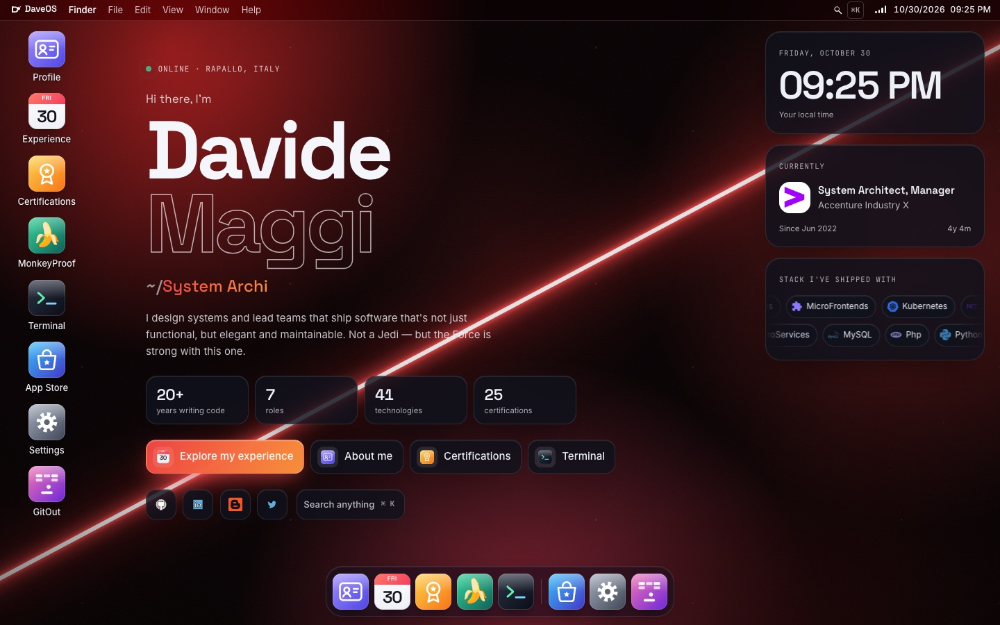
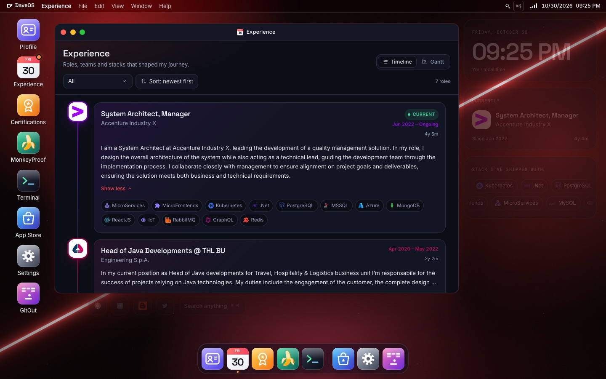
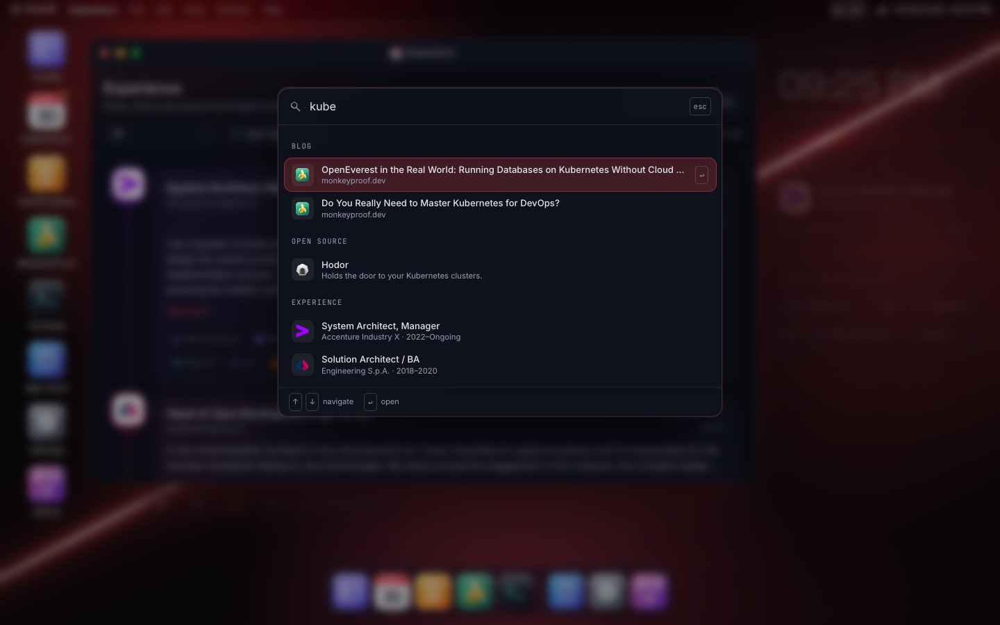
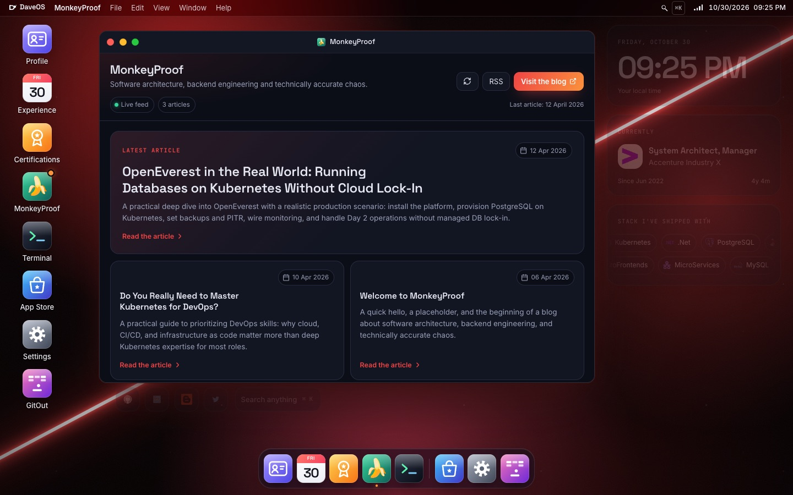
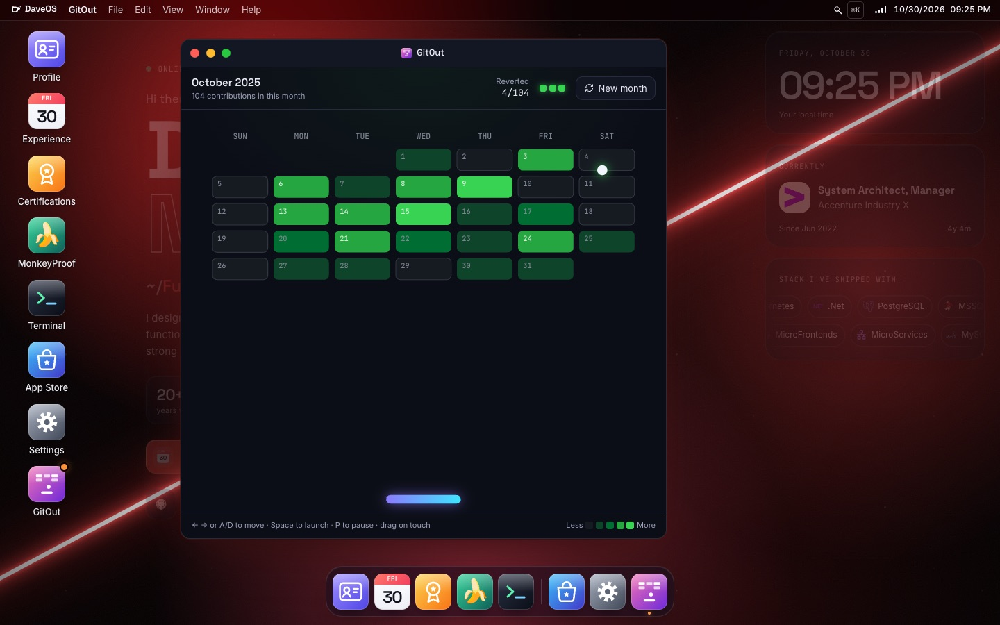
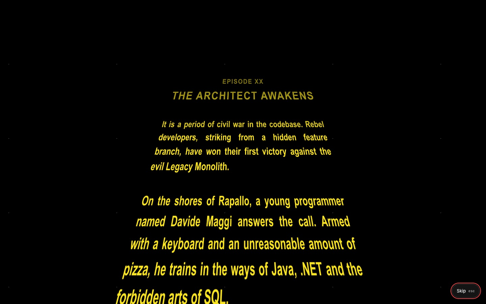
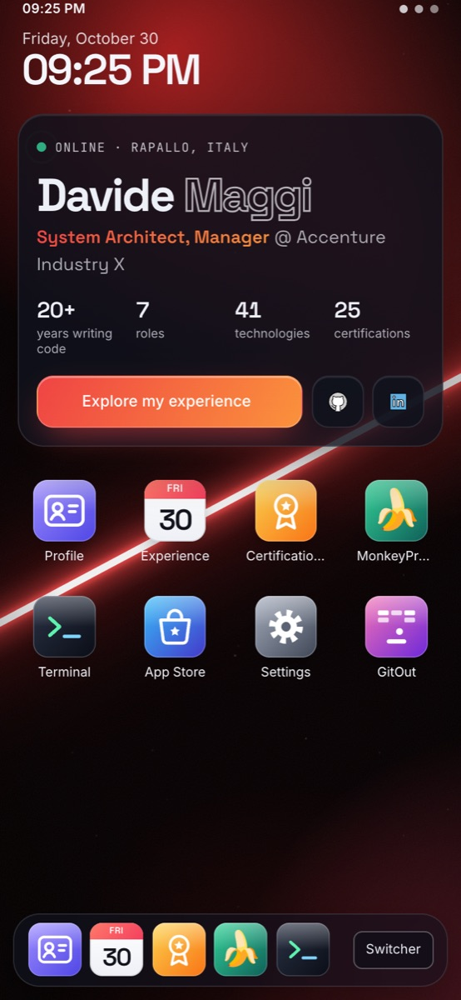

<div align="center">

# DaveOS

**My personal site, disguised as an operating system.**

Draggable windows, a dock, a ⌘K command palette, a playable GitHub-contributions Arkanoid,<br>
and at least one thing you're not supposed to find.

[**davidemaggi.dev →**](https://davidemaggi.dev)

[](https://github.com/davidemaggi/davidemaggi.dev/releases)
[](https://github.com/davidemaggi/davidemaggi.dev/actions/workflows/docker-build-push.yml)


<br>



</div>

---

## Why a desktop?

A CV is a list. A desktop is a place you can poke around in.

Every section of the site is an **app**: open it, drag it, snap it to half the screen, minimize it to the dock, or skip the clicking entirely and type what you're looking for in the command palette. It works on phones too, where DaveOS turns into a mobile home screen.

<table>
  <tr>
    <td width="50%"></td>
    <td width="50%"></td>
  </tr>
  <tr>
    <td align="center"><sub><b>Experience</b> · timeline and Gantt views of 20 years of roles</sub></td>
    <td align="center"><sub><b>⌘K / Ctrl K</b> · search apps, posts, projects, roles and certifications</sub></td>
  </tr>
  <tr>
    <td width="50%"></td>
    <td width="50%"></td>
  </tr>
  <tr>
    <td align="center"><sub><b>MonkeyProof</b> · the blog, typed by infinite monkeys</sub></td>
    <td align="center"><sub><b>GitOut</b> · break a random month of GitHub contributions</sub></td>
  </tr>
</table>

## What's inside

| App | What it does |
| --- | --- |
| **Profile** | Bio, contacts, languages, interests and the causes I support. |
| **Experience** | Career timeline with filters by technology, plus a Gantt view for the calendar nerds. |
| **Certifications** | Every certification as a card; open one to get a proper diploma, signature verified by DaveOS. |
| **MonkeyProof** | My [blog](https://monkeyproof.dev). Opens with the *Infinite Monkey Theorem* playing out, then reads the live RSS feed and lets you read articles right inside the window. |
| **Terminal** | A shell that (mostly) works: `help`, `neofetch`, `open <app>`, `theme`, `wallpaper`, `blog`, `projects`, `ping`… |
| **App Store** | My open source projects ([Hodor](https://github.com/davidemaggi/Hodor), [QueueCumber](https://github.com/davidemaggi/QueueCumber)) with live stars, forks and the latest release from GitHub. |
| **Settings** | Light or dark theme, ten wallpapers (several of them animated, plus one you have to earn), language, clock formats. |
| **GitOut** | Arkanoid, but the bricks are a random month of GitHub contributions. Greener days need more hits. |

And around the apps: a boot sequence, a menu bar with a (very fictional) Wi-Fi menu, sleep, restart and a shutdown that doesn't quite go as planned, live desktop widgets, Italian and English everywhere.

<details>
<summary><b>🔒 Secrets</b> (spoilers, obviously)</summary>
<br>

There is an easter egg. The boot log hints at how to wake it up, and if you're on a phone, the name on the home screen is worth a few taps. The terminal also knows a few commands that `help` doesn't mention.

What happens next involves a long time ago, a repository far, far away, and my favourite starship.



<sub>Star Wars is a trademark of Lucasfilm Ltd. This is a fan tribute and is not affiliated with or endorsed by Lucasfilm.</sub>
</details>

<div align="center">
  <br>
  
  <br>
  <sub>On phones, DaveOS becomes a home screen with full-screen apps.</sub>
</div>

## Under the hood

- **React 19 + TypeScript + Vite 8**, styled with **Tailwind CSS 4** and a hand-written design system (tokens in `src/App.css`).
- **A real window manager**: z-order, drag, resize from every edge, snap to halves, maximize, and windows that remember where you left them.
- **Built to stay at 60 FPS**: window moves happen on the compositor, input is coalesced to one update per frame, app contents never re-render while you drag, and expensive effects like backdrop blur are kept to a few large surfaces.
- **Kind to everyone**: keyboard navigation, visible focus, screen-reader labels, and `prefers-reduced-motion` respected by every animation (the opening crawl included).
- **No backend**: content lives in typed files in the repo. Besides the web fonts, the only network calls are the GitHub API (project stats) and the blog feed, which goes through a same-origin proxy because it has no CORS headers.

## Running it locally

You need **Node.js 22** and **npm 10.9.4** (pinned in `package.json` so CI can verify the lockfile).

```bash
npm ci
npm run dev        # http://localhost:5173
npm run dev:lan    # same, reachable from other devices on your network
npm run build      # type-check and production build in dist/
npm run lint
```

## Making it yours

Almost everything you see is data, not code:

| To change… | Edit |
| --- | --- |
| Bio, contacts, interests | `src/desktop/resources/about/{en,it}.ts` |
| Work experience | `src/desktop/resources/calendar/{en,it}.ts` (technology tags in `tags.ts`) |
| Certifications | `src/desktop/resources/certManager/{en,it}.ts` |
| App Store projects | one file per project in `src/desktop/resources/projects/`, icon in `public/projects/<id>/` |
| Blog | `src/desktop/resources/blog/index.ts` (feed path and offline fallback posts) |
| Social links on the desktop | `src/desktop/resources/profile/index.ts` |
| UI strings | `src/desktop/locales/{en,it}.ts` |

To add a new app: give it an id in `src/desktop/types.ts`, register it in `src/desktop/plugins.tsx` (title, icon, default window size and component), add its id to the per-app map in `src/desktop-shell/hooks/useWindowManager.ts`, and put its title in the locales. It shows up on the desktop, in the dock, in the command palette and in the terminal's `open` command.

<details>
<summary>Project layout</summary>

```text
src/
├── App.tsx              shell: windows, dock, menu bar, boot, easter egg
├── App.css              design tokens and component styles
├── apps/                one component per app (+ helpers in subfolders)
├── desktop/
│   ├── plugins.tsx      app registry
│   ├── resources/       all the content (about, experience, certifications, projects, blog…)
│   └── locales/         Italian and English strings
├── desktop-shell/       window manager, dock, menu bar, palette, wallpapers, hero
└── mobile-shell/        phone home screen
public/                  icons, project logos, avatar
docker/nginx.conf        production server (static files + blog feed proxy)
```
</details>

## Releases and deployment

Releases are fully automatic and driven by [Conventional Commits](https://www.conventionalcommits.org/):

| Commit | Version bump |
| --- | --- |
| `fix: …` | patch |
| `feat: …` | minor |
| `feat!: …` or `BREAKING CHANGE` | major |

On every push to `main`, [semantic-release](https://github.com/semantic-release/semantic-release) works out the next version, updates `CHANGELOG.md` and `package.json`, tags `vX.Y.Z` and publishes a GitHub release. Only when a release is published, the workflow builds the Docker image and pushes it to GitHub Container Registry as `X.Y.Z`, `vX.Y.Z` and `latest`.

```bash
docker run -d -p 8080:80 ghcr.io/davidemaggi/davidemaggi.dev:latest
# or
docker compose up -d
```

The image is a two-stage build: Node builds the site, then **nginx** serves `dist/` with immutable caching for fingerprinted assets and the same-origin proxy for the blog feed.

---

<div align="center">
<sub>Built by <a href="https://davidemaggi.dev">Davide Maggi</a> in Rapallo, with an unreasonable amount of pizza. May the Force be with you and your code.</sub>
</div>
